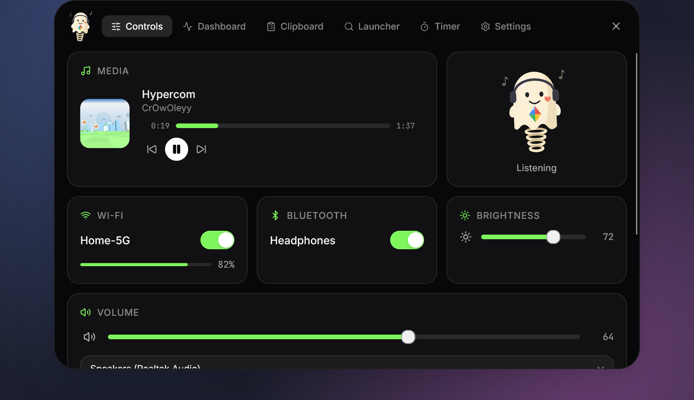
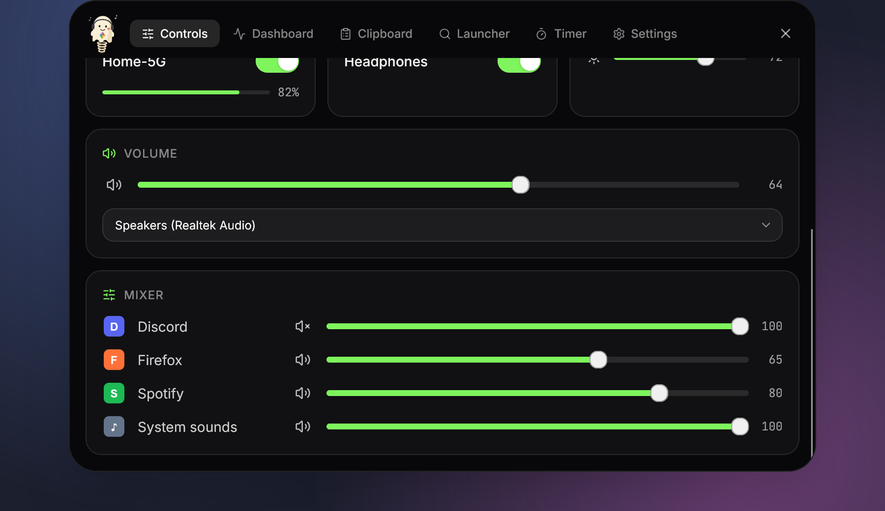
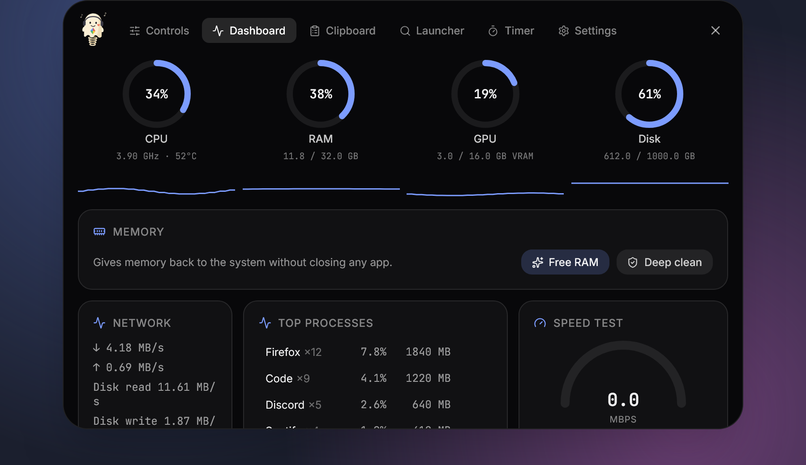
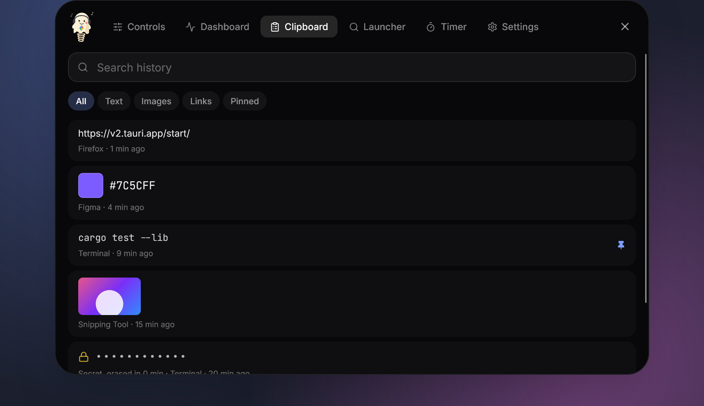
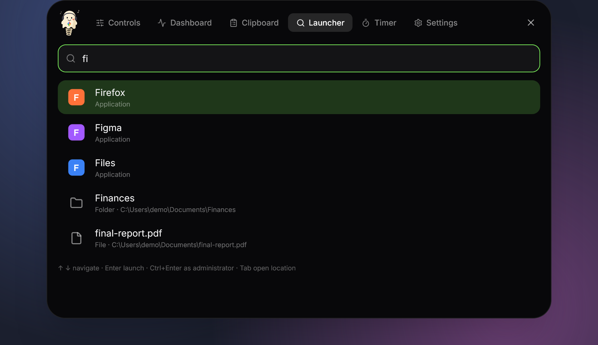
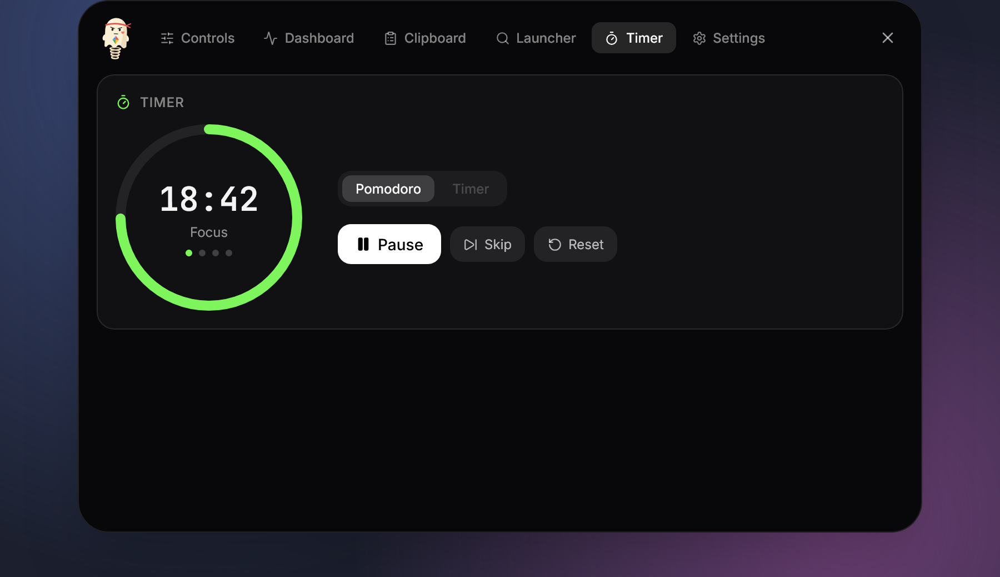
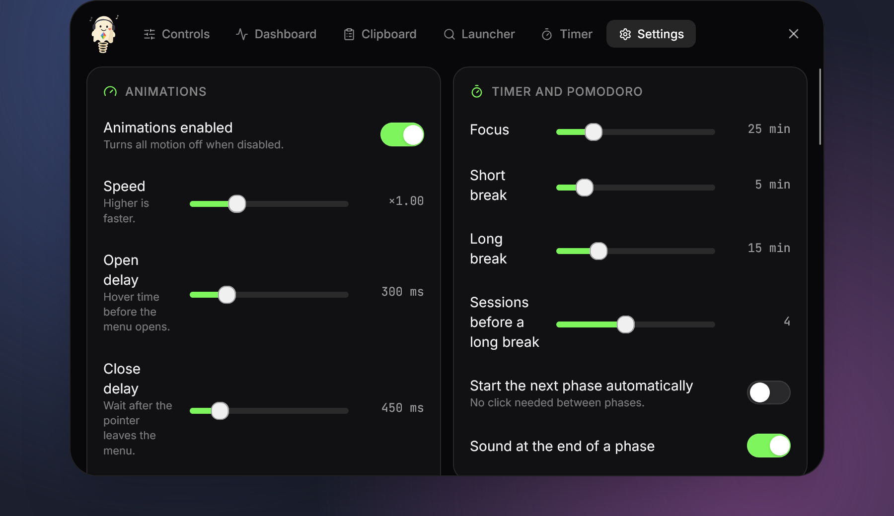
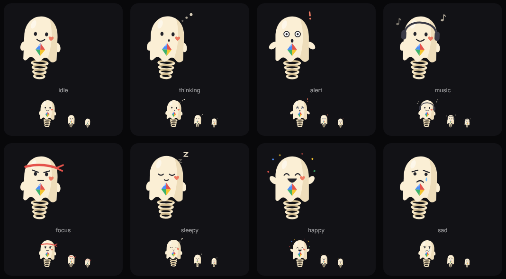

<p align="center">
  
</p>

<h1 align="center">Katadacho</h1>

<p align="center">
  A Dynamic Island for your desktop: system controls, live stats, clipboard history, an app launcher,<br />
  a Pomodoro timer and notifications, in one pill at the top of the screen.
</p>

<p align="center">
  
  
  
  
</p>

<p align="center">
  
</p>

<p align="center">
  
</p>

> **Status:** version 0.1.0, in active development. Windows 11 is the main platform; Linux works and is
> tested on Fedora. macOS is not supported yet.

## Contents

- [Features](#features)
- [The mascot](#the-mascot)
- [Claude Desktop integration](#claude-desktop-integration)
- [Platform support](#platform-support)
- [Installation](#installation)
- [Building from source](#building-from-source)
- [Usage](#usage)
- [Privacy](#privacy)
- [Architecture](#architecture)
- [Testing](#testing)
- [Known limitations](#known-limitations)
- [Contributing](#contributing)
- [License](#license)

## Features

The island lives at the top of the screen as a small pill. Hover it (or click it) and it opens into a menu
with six tabs. Transparent areas let clicks through to the windows below, so it never gets in the way.

### Controls

Volume and output device, brightness (laptop panels and external monitors over DDC/CI), Wi-Fi and
Bluetooth, and media playback with album art, seek bar and play, pause, next and previous.

The **mixer** sets the volume of each app on its own, with the app's real name and icon. Apps that open
several audio streams (a browser, a voice chat) get a single slider.

<p align="center">
  
</p>

### Dashboard

CPU, RAM, GPU and disk in real time with history, network and disk throughput, the top processes grouped
by app (with a button to end them), a built-in speed test, and a RAM cleaner.

<p align="center">
  
</p>

### Clipboard

An unlimited history of everything you copy (text, links, colors, code, images) with instant search,
filters, pinning, and one-click paste back into the previous window. Copies made from a password manager
are never saved, and secrets copied by hand (API keys, tokens) are hidden and erased after a few minutes.

<p align="center">
  
</p>

### Launcher

A fast launcher for your apps, files and folders, with fuzzy search, opened from anywhere with a global
shortcut (Alt + Space by default, or the Copilot key on Windows).

<p align="center">
  
</p>

### Timer

Pomodoro (focus, short break, long break) and a plain countdown. While it runs, a chip with the time left
stays in the pill, and a sound plays at the end of each phase.

<p align="center">
  
</p>

### Notifications and settings

Notifications from other apps appear as a banner in the pill, with a queue, an adjustable display time and
a list of apps to ignore. Everything is configurable: animation speed and delays, auto-hide, Pomodoro
durations, the mascot's behavior, launch at sign-in and the launcher shortcut.

<p align="center">
  
</p>

## The mascot

A small ghost sits in the pill and reacts to what you are doing: it listens to music with you, focuses
during a Pomodoro, falls asleep when you are away or late at night, cheers after a successful task and
looks sad when something fails.

<p align="center">
  
</p>

## Claude Desktop integration

Katadacho can act as a local [MCP](https://modelcontextprotocol.io) server for Claude Desktop, with no API
key. In **Settings**, under **Claude Desktop**, click **Connect**, then restart Claude Desktop. Claude gets
two tools:

| Tool | What it does |
|---|---|
| `notify_island` | Shows a notification in the island, for example when a long task finishes. |
| `ask_user_in_island` | Asks you a question with 2 to 4 answer buttons and waits for your choice. |

The bridge only listens on `127.0.0.1`, with a random port and a secret token.

## Platform support

| Feature | Windows 11 | Linux |
|---|---|---|
| Island, tabs, tray icon, launch at sign-in | Yes | Yes (see the Wayland note below) |
| Volume, output device, mixer | Core Audio | `pactl` (PipeWire or PulseAudio) |
| Brightness | WMI and DDC/CI | Backlight through logind, or `brightnessctl` |
| Wi-Fi and Bluetooth | Native APIs | `nmcli` and `bluetoothctl` |
| Now playing and media keys | System media controls | MPRIS |
| Clipboard history | Yes | Yes (X11 and Wayland) |
| Notifications in the pill | Yes, after granting access | Yes, read from D-Bus |
| RAM cleaner | Quick and deep | Deep only, asks for your password |
| Live waveform, idle and fullscreen detection, Copilot key | Yes | Not yet |

**Wayland:** the island uses the layer-shell protocol, so it stays pinned at the top of the screen on
compositors that support it, such as KDE Plasma, niri, Hyprland and Sway (tested on Sway). GNOME does not
support layer-shell: there the island is an ordinary window that the desktop may place elsewhere. Set
`KATADACHO_NO_LAYER_SHELL=1` to turn layer-shell off.

## Installation

Download the latest version from the [Releases](https://github.com/CrOwOleyy/Katadacho/releases) page:

- **Windows:** `katadacho_<version>_x64-setup.exe`. It bundles WebView2, so it works on a fresh machine, and
  installs for the current user without administrator rights.
- **Linux:** the `.AppImage` runs on most distributions (`chmod +x`, then run it). Use the `.deb` on Debian and
  Ubuntu, and the `.rpm` on Fedora.

The installers are not code-signed yet, so Windows SmartScreen may warn about an unknown publisher on first
launch: choose **More info**, then **Run anyway**.

## Building from source

### Requirements

| Tool | Version |
|---|---|
| Rust | 1.85 or later (the project uses the 2024 edition) |
| Node.js | 20.19 or later, or 22.12 or later (required by Vite) |
| pnpm | Recent |

**Windows:** Visual Studio Build Tools 2022 with the "Desktop development with C++" workload. WebView2 is
already part of Windows 11.

> Smart App Control blocks unsigned executables, including the one Cargo builds, and `pnpm tauri dev` then
> fails with `os error 4551`. To develop, turn it off in Windows Security, under App & browser control. This
> cannot be undone without reinstalling Windows.

**Linux:** WebKitGTK 4.1, GTK layer-shell and the usual build tools.

```bash
# Fedora (tested)
sudo dnf install webkit2gtk4.1-devel openssl-devel libappindicator-gtk3-devel librsvg2-devel libxdo-devel gtk-layer-shell-devel gcc gcc-c++ make
```

```bash
# Debian and Ubuntu
sudo apt install libwebkit2gtk-4.1-dev build-essential libssl-dev libayatana-appindicator3-dev librsvg2-dev libxdo-dev libgtk-layer-shell-dev
```

```bash
# Arch
sudo pacman -S --needed webkit2gtk-4.1 base-devel openssl libappindicator-gtk3 librsvg xdotool gtk-layer-shell
```

Only the Fedora list is tested; the other two follow the Tauri prerequisites.

At runtime, the Linux features call standard tools: `pactl`, `nmcli`, `bluetoothctl` and `pkexec` (polkit).
Optional: `xdotool` (X11) or `wtype` (Wayland) to paste automatically from the clipboard history, and
`wl-paste` or `xclip` to recognize password manager copies. A missing tool shows a clear message instead of
breaking the app.

### Run and build

```bash
pnpm install
```

```bash
pnpm tauri dev
```

The first Rust build takes several minutes. To build the installers:

```bash
pnpm tauri build
```

Linux packages can also be built in a Fedora container, from any host with Docker:

```bash
docker build -t katadacho-fedora -f packaging/linux/fedora.Dockerfile packaging/linux
```

```bash
docker run --rm -v "$PWD:/repo:ro" -v "$PWD/out:/out" katadacho-fedora bash /repo/packaging/linux/build-in-container.sh bundle appimage
```

## Usage

- **Open the menu:** hover the pill for a moment, or click it. The delay is set in Settings.
- **Close the menu:** move the pointer away, press `Esc`, or click the cross.
- **Launcher:** press the shortcut from any app, then `↑` `↓` to move, `Enter` to launch,
  `Ctrl + Enter` to launch as administrator and `Tab` to open the file location.
- **Hidden island:** when the island hides, a thin bar stays at the top of the screen; hover it to bring
  the island back.
- **Tray icon:** left click opens the island; right click shows Settings, Restart and Quit.
- **Notifications on Windows:** grant access once in Settings, under Notifications.

## Privacy

Everything stays on your machine, in `%LocalAppData%\Katadacho` on Windows and `~/.local/share/Katadacho`
on Linux: a SQLite database (clipboard history and settings), copied images, and cached app icons.

- **The clipboard history records what you copy.** Password manager copies are skipped, and text that looks
  like a secret is hidden and erased automatically, but other sensitive text you copy is kept until you
  delete it.
- **Notifications can show their content** in the pill. If you share your screen, turn off "Show content"
  in Settings.
- **Network calls:** the speed test contacts `speed.cloudflare.com` when you run it. On Linux, when a
  player publishes its album art as a web address (Spotify does), the cover is downloaded from there.
  Nothing else leaves your machine.

## Architecture

```text
React (WebView)  <--- Tauri commands and events --->  Rust (native system APIs)
```

- A single transparent, undecorated, always-on-top window named `island`. The pill only fills part of it.
- **Click-through:** the frontend sends Rust the exact rectangle of the pill. On Windows and X11, a Rust
  thread follows the cursor and only lets the window take the mouse over the pill. Under Wayland
  layer-shell, the input region is set to the pill directly.
- **One-off actions** are async `#[tauri::command]` functions that run on worker threads, so the interface
  never blocks.
- **Live data** comes through Tauri events (`system-stats`, `clipboard-updated`, `media-changed`,
  `audio-level`, `timer-update`, `notification-arrived`, `settings-changed`) and a `Channel` for the speed
  test progress.
- **No PowerShell:** Windows features use the `windows` crate (Win32, COM and WinRT). Each platform-specific
  module has a Windows and a Linux implementation behind a shared interface.
- Collectors only run when needed: telemetry while the Dashboard is open, the audio level while media
  plays, the timer only during a countdown.

```text
src/                        React interface
  island/IslandApp.tsx      Pill, tabs, opening and closing
  features/                 controls, dashboard, clipboard, launcher, media, timer,
                            notifications, settings, ai
  components/               UI building blocks and the mascot
  hooks/                    Tauri hooks (stats, media, timer, notifications, icons)
  store/SettingsContext.tsx Shared settings with debounced saving
  screenshots/              Page that renders the island with mock data (README images)

src-tauri/src/              Rust backend
  window/                   Positioning, click-through, Wayland layer-shell
  controls/                 Audio, mixer, brightness, Wi-Fi, Bluetooth
  telemetry/                CPU, RAM, disk, network, processes, GPU
  clipboard/                Capture, storage, secrets, paste
  launcher/                 Index, fuzzy search, icons, global shortcut
  media/                    Now playing, playback controls, audio level
  notifications/            Windows toasts and Linux D-Bus notifications
  mcp/                      MCP server and local bridge for Claude Desktop
  memory/, timer/, speedtest/, db/, settings.rs, tray.rs

packaging/linux/            Fedora build image, container scripts and smoke tests
```

## Testing

```bash
pnpm test
```

```bash
cd src-tauri && cargo test --lib
```

Some Rust tests are ignored by default because they need real hardware or apps, for example the mixer test
that reads the audio sessions of the apps playing right now. Run them by name with `-- --ignored`.

The Linux code is tested in the Fedora container: `build-in-container.sh test` runs the Rust tests,
`wayland-smoke-test.sh` starts the app in a headless Sway session and checks the island is a layer-shell
surface, and `mixer-smoke-test.sh` drives the mixer against a real PipeWire server.

The README images come from `screenshots.html`: run `pnpm dev`, then open
`http://localhost:1420/screenshots.html?scene=controls` (scenes: `pill`, `controls`, `mixer`, `dashboard`,
`clipboard`, `launcher`, `timer`, `settings`). The page renders the real interface with fictional data.

## Known limitations

- The installers are not code-signed.
- On GNOME (Wayland), the island cannot be pinned to the top of the screen.
- Some features are Windows only for now: the live waveform, idle and fullscreen detection, the Copilot key,
  quick RAM cleaning and launching as administrator.
- The launcher indexes apps and a few folders of your profile, not the whole disk.
- macOS is not supported.

## Contributing

Contributions are welcome. Read [CONTRIBUTING.md](CONTRIBUTING.md) for the setup, conventions and pull
request checklist, and [CODE_OF_CONDUCT.md](CODE_OF_CONDUCT.md). To report a vulnerability, see
[SECURITY.md](SECURITY.md).

## License

Katadacho is released under the [MIT License](LICENSE). Copyright (c) 2026 Leyy.
